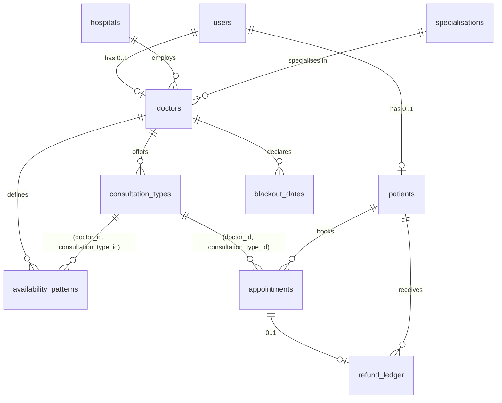

# Data model

Source of truth: the schema diagrams in this folder
([RDS](MediSlot%20RDS%20MySQL%20Schema%20Diagram.png), [DynamoDB](MediSlot%20DynamoDB%20Schema%20Infographic%20(1).png)).
The DDL is `database/schema.sql`; the database is built and upgraded by the migrations in `database/migrations`
(applied by the `db-migrate` Lambda in every deployment).

## Why two stores

| Store | Holds | Why |
|---|---|---|
| **RDS MySQL** (system of record) | users, patients, doctors, hospitals, specialisations, consultation types, availability patterns, blackout dates, appointments, refund ledger | Relational and auditable. Doctors join hospitals, specialisations and consultation types; search filters on several attributes at once; appointments join patients, doctors and refunds. Foreign keys, unique constraints and a generated column protect integrity. |
| **DynamoDB** (contended, short-lived state) | slots, seats, waitlist, hold offers, idempotency keys, refresh tokens, token denylist, notification dispatch log | Every access is by key. The slot item is the contended write target and needs **conditional writes and transactions**, which give a hard guarantee against overbooking without a lock. TTL removes tokens, keys and offers automatically. |

The appointment row in RDS is the record. DynamoDB holds the live seat count. The two are not updated
atomically; [design/concurrency.md](design/concurrency.md) states exactly what that means.

## RDS MySQL

| Table | Key columns | Constraints |
|---|---|---|
| users | user_id CHAR(36) | email UNIQUE (one account per email, across both roles); role ENUM('patient','doctor') NOT NULL |
| patients | patient_id, user_id | user_id UNIQUE FK users |
| doctors | doctor_id, user_id, hospital_id, specialisation_id | user_id UNIQUE; licence_number UNIQUE; years_experience 0–80; **timezone** (IANA, see below) |
| hospitals | hospital_id INT | UNIQUE(name, city), so registration can find-or-create a hospital safely |
| specialisations | specialisation_id INT | name UNIQUE; seeded catalogue (V004) |
| consultation_types | consultation_type_id INT | UNIQUE(doctor_id, consultation_type_id) (target of the composite FKs); CHECK duration in 15/30/60; CHECK Health Camp Session = 60 min and capacity 2–10, any other type capacity 1 |
| availability_patterns | availability_id | composite FK (doctor_id, consultation_type_id) → consultation_types; day_of_week 1–7 (ISO, Monday = 1); end_time > start_time; times are the doctor's local time |
| blackout_dates | blackout_id | UNIQUE(doctor_id, date) |
| appointments | appointment_id | composite FK (doctor_id, consultation_type_id); slot_id NOT NULL; **active_slot_id** generated (= slot_id while CONFIRMED, else NULL) with UNIQUE(patient_id, active_slot_id): one confirmed appointment per patient per slot; UNIQUE(patient_id, idempotency_key); reschedule_count 0–2 |
| refund_ledger | refund_id | appointment_id UNIQUE (one refund per appointment, so a retry cannot refund twice); tier ENUM('FULL','PARTIAL','NONE') |

`slot_id` points at the DynamoDB slots table, so it is a logical reference rather than a MySQL foreign key.
`availability_id` on appointments is a plain column, as on the diagram.

**One addition to the diagram: `doctors.timezone`.** The frozen rules require each doctor's home time zone as an
IANA identifier, and the slots table stores the zone with every slot, so the value has to be stored somewhere.
It defaults to the SSM value `config/doctors/default-timezone` (Asia/Kolkata).

### Indexes and the queries they serve

Every index is justified by a query in the code. The search plans below are real `EXPLAIN` output from MySQL with
2,000 doctors, 300 hospitals and 1,000 patients loaded (`tests/unit/test_patient_domain.py::test_search_uses_indexes`
keeps the name case in CI).

| Index | Query (file) | Why this shape |
|---|---|---|
| users **(role, full_name)** | Search by name: `role = 'doctor' AND full_name LIKE 'Ani%' ORDER BY full_name` (doctor_search) | Equality on role, then a range on the name prefix. The same order serves the ORDER BY, so no filesort. |
| hospitals **(city, name)** | Search by city, or city + hospital (doctor_search) | Equality on city, then the hospital name prefix. |
| hospitals UNIQUE **(name, city)** | Search by hospital name alone; find-or-create at registration | The leading column serves `name LIKE 'Apollo%'`. |
| specialisations UNIQUE **(name)** | Search by specialisation (constant lookup) | One row, resolved first. |
| doctors **(specialisation_id, hospital_id)** | Search by specialisation, optionally with hospital/city | Drives the join from the one specialisation row; the second column helps when a hospital is also known. |
| doctors FK index (hospital_id) | Search by city or hospital | Join from the matched hospitals to their doctors. |
| consultation_types **(doctor_id, is_active)** | Public profile, slot lookup, materialiser | A doctor's active types. |
| availability_patterns **(doctor_id, is_active, day_of_week)** | Materialiser and availability editor | A doctor's active patterns in weekday order. |
| appointments **(doctor_id, slot_start_utc, status)** | Doctor schedule (day/week) and appointment list | One doctor, a time range, filtered by status. |
| appointments **(patient_id, slot_start_utc, status)** | Patient appointment list; the 3-upcoming-per-doctor check (M5) | One patient's upcoming and past appointments. |
| appointments **(slot_id, status)** | Doctor slot cancellation (M5/M6): every patient in a slot | |
| refund_ledger **(patient_id, created_at)** | Refund history, newest first (M5) | |

`EXPLAIN` for every combination of the four search filters (u = users, d = doctors, h = hospitals, s = specialisations):

| Filters | Plan (table: access / index) |
|---|---|
| none | u: ref / idx_users_role_full_name → d, s, h by primary/unique key |
| name | u: **range** / idx_users_role_full_name |
| hospital | h: **range** / uq_hospitals_name_city → d: ref / fk_doctors_hospital |
| specialisation | s: const / uq_specialisations_name → d: ref / idx_doctors_specialisation_hospital |
| city | h: ref / idx_hospitals_city_name → d: ref / fk_doctors_hospital |
| name + hospital | u: range / idx_users_role_full_name |
| name + specialisation | s: const → u: range / idx_users_role_full_name |
| name + city | u: range / idx_users_role_full_name |
| hospital + specialisation | s: const → h: range / uq_hospitals_name_city → d: ref / idx_doctors_specialisation_hospital |
| hospital + city | h: range / idx_hospitals_city_name |
| specialisation + city | s: const → h: ref / idx_hospitals_city_name → d: ref / idx_doctors_specialisation_hospital |
| any three or all four | s: const → h: range / idx_hospitals_city_name or uq_hospitals_name_city → d: ref / idx_doctors_specialisation_hospital |

No combination does a full table scan. Name and hospital filters match the **start** of the text so that a B-tree
index can serve them. A word-anywhere search ("Sharma" inside "Anil Sharma") would need a FULLTEXT index; that is a
possible next step if search measurements show it is needed.

Pagination: `page` and `page_size` (default and maximum in SSM). The query fetches one extra row to answer
`has_more` without a COUNT.

## DynamoDB

| Table | Keys | Indexes | TTL | Access patterns |
|---|---|---|---|---|
| refresh-tokens | PK tokenHash (SHA-256 of the token) | | expiresAt | Login: put. Refresh: get, then one transaction deletes the old hash (conditional on owner and expiry) and puts the new one. Logout: conditional delete. |
| token-revocations | PK jti | | expiresAt | Logout and account deletion: put jti with the token's own expiry. Authorizer: consistent get on every request. |
| slots | PK slotId = `<doctorId>#<consultationTypeId>#<YYYYMMDD>#<HHMM>` (local date and time, deterministic) | GSI_Doctor_Slots: doctorId + startTime (UTC ISO) | | Materialiser: conditional put (attribute_not_exists). Schedule and slot lookup: query GSI by doctor and time range. Booking (M5): conditional update on version and capacity. |
| seats | PK slotId, SK patientId | | | Booking: conditional put, so a patient holds at most one seat per slot. Cancel: delete. |
| waitlist | PK slotId, SK patientId | LSI_QueueOrder (slotId + queueOrder); GSI_Patient_Waitlists (patientId + createdAt) | | Join: conditional put (no duplicate per slot), queueOrder from an atomic counter on the slot item. Next in line: query the LSI. "My waitlists": query the GSI. |
| hold-offers | PK offerId | GSI_Patient_Offers (patientId + createdAt); GSI_Slot_Offers (slotId + createdAt) | ttl (cleanup only; expiresAt drives the logic) | Live offer for a slot, offers for a patient, conditional status changes LIVE → ACCEPTED / EXPIRED. |
| idempotency | PK `patientId#key` = `<patientId>#<Idempotency-Key>` | | expiresAt (24 h, SSM) | Booking: conditional put IN_PROGRESS, then the stored response on replay. Scoped per patient, so keys from two patients never collide. |
| dispatch-log | PK dispatchKey | | | Notification and reminder: conditional put before sending, so each notification goes out once. |

Slot item attributes (as on the diagram): slotId, doctorId, consultationTypeId, startTime, endTime (UTC ISO 8601),
timezone (IANA), status (OPEN or CANCELLED), capacity, bookedCount, heldCount, version.
Free seats = capacity − bookedCount − heldCount.

All tables are on-demand (pay per request), encrypted with AWS-owned keys, and have point-in-time recovery on.

## Changes from the earlier schema.sql

`V002__align_with_final_schema.sql` upgrades a database created from the earlier `schema.sql`:

- doctors: removed first_name, last_name, phone, city, state, country, bio, is_active (name is `users.full_name`,
  city is the hospital's city, active is `users.is_active`). years_experience is INT.
- availability_patterns: removed effective_from and effective_until (not on the diagram).
- appointments: removed active_flag; availability_id is a plain nullable column (no FK); counters are INT.
- consultation_types: INT columns; duration limited to 15/30/60.
- refund_ledger: tier enum in diagram order.
- Old indexes replaced by the ones above.

`tests/unit/test_migrations.py` checks that the upgraded database and a freshly built one end up identical.
